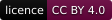

  <picture>
    <source media="(max-width: 600px) and (prefers-color-scheme: light)" srcset=".github/assets/banner-phone-light.svg">
    <source media="(max-width: 600px)" srcset=".github/assets/banner-phone.svg">
    <source media="(prefers-color-scheme: light)" srcset=".github/assets/banner-light.svg">
    
  </picture>

 
 

GitHub applies these account-level defaults to public repositories owned by
[@ryanduguid](https://github.com/ryanduguid) when a repository does not provide
its own version.

The issue and pull request templates require fabricated examples and keep
client, taxpayer, employee, payroll, credential and other sensitive data out of
public project discussions.

## What a repository inherits

| File | What it does |
| --- | --- |
| `CODE_OF_CONDUCT.md` | Sets the behaviour standard for issues, pull requests and discussions, including the rule against posting someone else's real data. |
| `CONTRIBUTING.md` | Explains how to strip data before opening anything and which issue form to use. It requires a primary-source citation for any changed rate, threshold or deadline. |
| `SECURITY.md` | Points a suspected vulnerability at the affected repository's private reporting feature instead of a public issue, and states the acknowledgement window. |
| `SUPPORT.md` | Routes bug reports, security reports and tax or accounting questions to the right channel, and says what these repositories are not. |
| `.github/ISSUE_TEMPLATE/bug_report.yml` | The bug form: a data-boundary checkbox, the actual result, the reproduction command and the smallest fabricated input. |
| `.github/ISSUE_TEMPLATE/feature_request.yml` | The feature or change form: a data-boundary checkbox, the workflow problem it solves and the proposal. |
| `.github/ISSUE_TEMPLATE/config.yml` | Turns off blank issues and offers the contact links for a security report and for tax or accounting advice. |
| `.github/PULL_REQUEST_TEMPLATE.md` | The pull request body: what changes, why with a primary source, verification commands and results, a final review tied to the head commit, and the merge checklist. |

A repository's own copy of any of these files overrides the default, and GitHub
then ignores the version here for that repository.

The [shared review process](docs/pr-review-process.md) explains the final record
and the evidence needed to assess reviewer usefulness and cost. Repositories
with their own templates need to adopt the same fields explicitly.

## What this repository keeps to itself

`.github/dependabot.yml`, `.github/CODEOWNERS`, `LICENSE`, `AGENTS.md` and the
workflows under `.github/workflows/` apply to this repository only. GitHub does
not inherit them, so each repository needs its own.

---

Better call <code>.github</code>. Made in Newcastle, Australia by <a href="https://duguid.com.au/">Ryan Duguid</a>.

